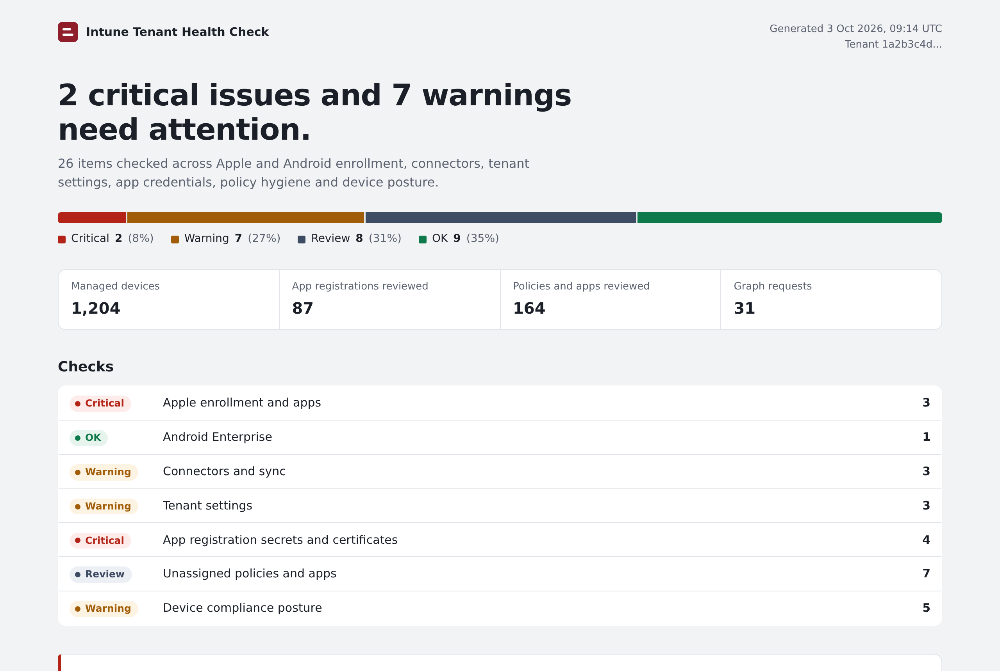
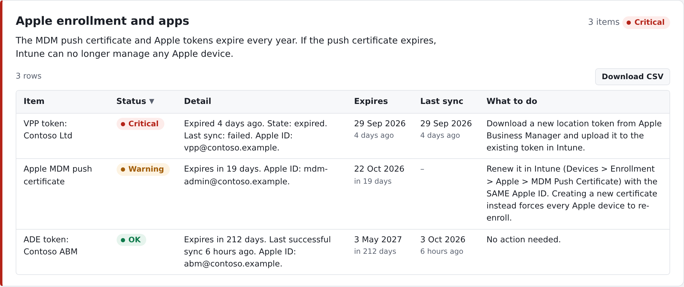
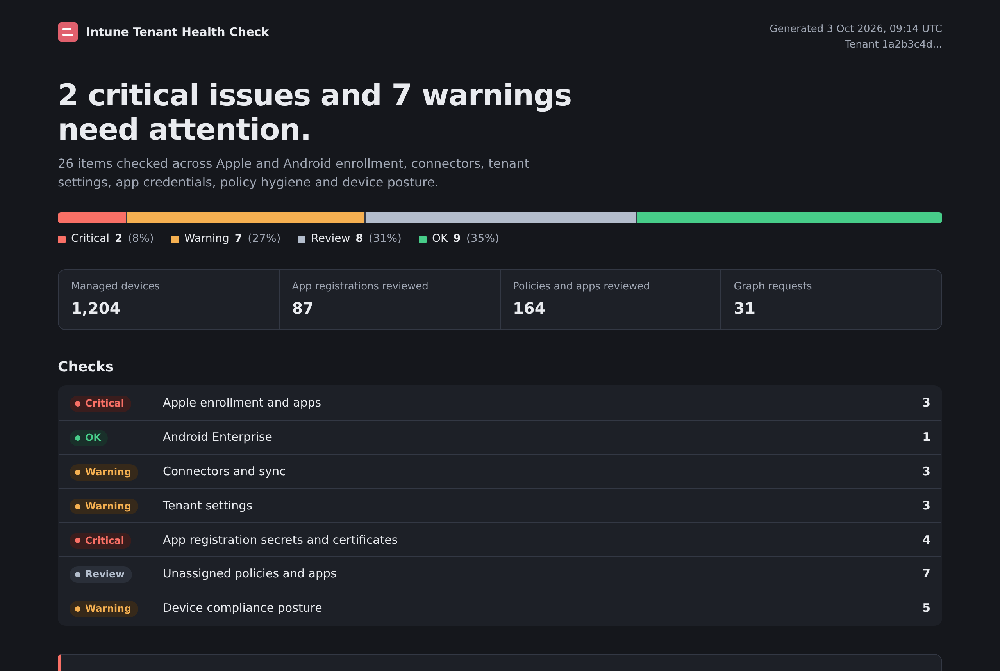

<div align="center">

# Intune Tenant Health Check

**One read-only scan that catches the Intune problems that break things quietly: expiring Apple tokens, dead connectors, app secrets about to expire, risky tenant settings and policy clutter.**


[](https://github.com/exentis-tech/intune-tenant-health-check/actions/workflows/ci.yml)



</div>

## Why

Some Intune failures give no warning until users call. The Apple MDM push certificate expires and every iPhone stops receiving policy. A VPP token lapses and app installs fail. The client secret behind an integration expires on a Friday night. Devices with no compliance policy quietly count as compliant.

Each of these is visible somewhere in the portal, but nobody checks ten different blades every week. This script checks them all in about a minute and gives you one report with a clear status and next step for each item.

**It never changes anything in your tenant.** It only reads.

## What it checks

| Area | Checks |
|---|---|
| **Apple** | MDM push certificate expiry (with the Apple ID to renew it with), automated device enrollment (ABM/ASM) token expiry and sync, VPP token expiry, state and sync |
| **Android** | Managed Google Play binding and app sync |
| **Connectors** | Mobile Threat Defense connectors (for example Microsoft Defender for Endpoint) heartbeat and state, NDES certificate connectors, Windows Autopilot sync |
| **Tenant settings** | Intune subscription state, *"Mark devices with no compliance policy assigned as"*, compliance status validity period |
| **App registrations** | Client secrets and certificates that expired or expire soon, with smart severity: critical only when the **last** valid credential is about to expire |
| **Hygiene** | Unassigned configuration profiles, settings catalog policies, compliance policies and apps, plus policies that share a name |
| **Device posture** | Compliance by platform, inactive devices, and devices still on Windows 10 after its end of support |

Every item gets one of five statuses: **Critical**, **Warning**, **Review**, **OK** or **Couldn't check** (for example when a permission is missing). One failing check never stops the rest of the report.

Open [`samples/sample-report.html`](samples/sample-report.html) to try a report with invented data, no tenant needed.

## Screenshots

| A finding with its next step | Dark mode |
|---|---|
|  |  |

## Quick start

**Requirements:** Windows PowerShell 5.1 or PowerShell 7+, and an Entra app registration with read-only Graph permissions. No modules to install.

```powershell
git clone https://github.com/exentis-tech/intune-tenant-health-check.git
cd intune-tenant-health-check
Get-ChildItem -Recurse | Unblock-File

# First run creates config.json and stops
.\Invoke-TenantHealthCheck.ps1
```

1. Create the app registration and fill in `config.json`: see the [app registration guide](docs/APP_REGISTRATION.md).
2. Run `.\Invoke-TenantHealthCheck.ps1` again (or double-click `Start-Report.bat`). The report opens in your browser

## Permissions

All are **Application** permissions, read-only, and need admin consent.

| Permission | Used for |
|---|---|
| `DeviceManagementServiceConfig.Read.All` | Apple push certificate, ADE and VPP tokens, connectors, Autopilot sync, tenant settings |
| `DeviceManagementConfiguration.Read.All` | Profiles, settings catalog and compliance policies, Managed Google Play, NDES connectors |
| `DeviceManagementApps.Read.All` | Apps |
| `DeviceManagementManagedDevices.Read.All` | Device posture |
| `Application.Read.All` | App registration credentials (optional, see `IncludeAppRegistrationCredentials`) |

## Configuration

| Setting | Default | Description |
|---|---|---|
| `TenantId`, `ApplicationId`, `ClientSecret` | | App registration details |
| `WarningDays` / `CriticalDays` | `30` / `7` | Expiry thresholds for certificates, tokens and secrets |
| `TokenSyncWarningHours` | `72` | Warn when an Apple enrollment token has not synced for this long |
| `ConnectorHeartbeatWarningHours` | `24` | Warn when a connector has not reported for this long |
| `InactiveDays` | `30` | Devices with no check-in for this long count as inactive |
| `NonCompliantWarningPercent` | `10` | Warning at this non-compliant share per platform, critical at double |
| `IncludeAppRegistrationCredentials` | `true` | Review every app registration's secrets and certificates (needs `Application.Read.All`) |
| `IncludePolicyHygiene` | `true` | Look for unassigned policies and apps |
| `GraphBaseUrl` / `GraphBetaBaseUrl` / `LoginBaseUrl` | Global cloud | Change for sovereign clouds |
| `RequestTimeoutSeconds` / `GraphMaxRetryCount` | `120` / `5` | Timeouts and retries for throttling |
| `ProxyUrl` / `UseDefaultProxyCredentials` | empty / `false` | Outbound proxy |

## Run it on a schedule

Use `-FailOn` to turn the result into an exit code for monitoring:

| `-FailOn` | Exit code |
|---|---|
| `None` (default) | Always 0 |
| `Critical` | 2 when anything is critical |
| `Warning` | 2 for critical, 1 for warnings |

Example weekly Windows scheduled task (run it as a dedicated account that can read `config.json`):

```powershell
$action  = New-ScheduledTaskAction -Execute 'powershell.exe' `
           -Argument '-NoProfile -ExecutionPolicy Bypass -File "C:\Tools\intune-tenant-health-check\Invoke-TenantHealthCheck.ps1" -NoOpen -FailOn Critical'
$trigger = New-ScheduledTaskTrigger -Weekly -DaysOfWeek Monday -At 7am
Register-ScheduledTask -TaskName 'Intune Tenant Health Check' -Action $action -Trigger $trigger
```

Each run writes a new timestamped folder in `reports/` with `report.html` and `report.json`.

## Notes

- Some checks use the Microsoft Graph **beta** endpoint (ADE tokens, Managed Google Play, NDES connectors, Autopilot settings, settings catalog). Microsoft can change beta APIs without notice; if one breaks, that check shows *Couldn't check* and the rest still runs.
- The report shows only the first 8 characters of your tenant ID, so screenshots are easier to share. It still contains Apple IDs and app names: review before sharing outside your team

## Development

Pure logic lives in `lib/` and is covered by Pester tests. CI runs them on Windows PowerShell 5.1 and PowerShell 7, together with PSScriptAnalyzer.

```powershell
Invoke-Pester -Path .\tests
```

## Part of a small Intune toolkit

| Tool | What it does |
|---|---|
| [Intune Device Lifecycle Console](https://github.com/exentis-tech/intune-device-lifecycle-console) | Safe bulk cleanup of Intune, Autopilot and Entra device records |
| [Intune Stale Device Report](https://github.com/exentis-tech/intune-stale-device-report) | Finds stale, orphaned and duplicate device records |
| [Intune Tenant Health Check](https://github.com/exentis-tech/intune-tenant-health-check) | Catches expiring tokens, broken connectors and risky settings |

## Contributing and security

New checks are very welcome: see [CONTRIBUTING.md](CONTRIBUTING.md). Report vulnerabilities privately as described in [SECURITY.md](SECURITY.md).

## Disclaimer

Not affiliated with or endorsed by Microsoft. Provided as is, without warranty.

## License

[MIT](LICENSE) © 2026 Marwen Mahmoud

## Author

**Marwen Mahmoud**, Microsoft 365 / Intune engineer
[exentis.tech](https://exentis.tech) · [LinkedIn](https://www.linkedin.com/in/marwen-mahmoud-58876a301/) · [GitHub](https://github.com/exentis-tech)
